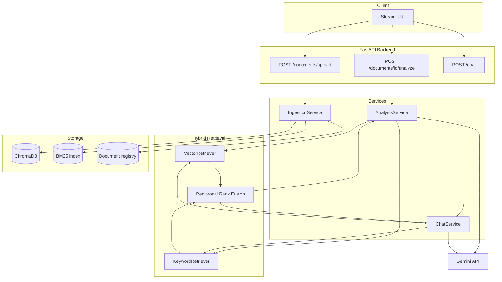

# 📰 Newsletter Intelligence System

An AI-powered system that turns an uploaded newsletter PDF into a grounded
executive summary, key insights, actionable items, and a citation-backed
conversational chatbot - built on a hybrid Retrieval-Augmented Generation
(RAG) pipeline (ChromaDB + BM25 + Reciprocal Rank Fusion) and Google's
Gemini API.

This is a **production-style portfolio implementation**, not a claim of a
production deployment: see [Limitations](#limitations) for what's
intentionally out of scope.

## Table of contents

- [Problem statement](#problem-statement)
- [Features](#features)
- [Architecture](#architecture)
- [Tech stack & why each piece was chosen](#tech-stack--why-each-piece-was-chosen)
- [Project structure](#project-structure)
- [Installation](#installation)
- [Environment variables](#environment-variables)
- [Running the backend](#running-the-backend)
- [Running the Streamlit UI](#running-the-streamlit-ui)
- [Docker setup](#docker-setup)
- [API examples](#api-examples)
- [Sample questions to try](#sample-questions-to-try)
- [RAG architecture: hybrid retrieval & RRF](#rag-architecture-hybrid-retrieval--rrf)
- [Chatbot architecture](#chatbot-architecture)
- [Testing](#testing)
- [Evaluation](#evaluation)
- [Security considerations](#security-considerations)
- [Limitations](#limitations)
- [Future improvements](#future-improvements)

## Problem statement

Newsletters pile up faster than anyone reads them. Reading one end-to-end
just to find "did anything need action this week?" or "what page mentioned
that risk?" is slow and error-prone, and asking a generic chatbot to
"summarize this PDF" gives answers with no way to check where they came
from. This system ingests a single newsletter PDF and gives back: a
grounded summary, categorized insights, explicit action items (never
invented owners/deadlines), extracted entities, and a chatbot that answers
follow-up questions with page-level citations - so every answer can be
checked against the source in seconds.

## Features

- PDF upload with validation (type, size, empty-file, content-sniffing)
- Page-aware chunking that keeps every chunk tied to exactly one page
- Hybrid retrieval: Hugging Face embeddings (ChromaDB) + BM25 keyword
  search, fused with Reciprocal Rank Fusion
- Gemini-powered executive summary, key insights, actionable items, and
  extracted entities (dates/organizations/products/people/numbers)
- Explicit vs. inferred labeling on every insight - the system never
  blurs "the document says X" with "the AI thinks X"
- Conversational chatbot over the uploaded PDF with bounded history and
  rule-based follow-up question resolution ("what are **its** risks?")
- Citations derived from retrieval metadata (never from model output) -
  see [Security considerations](#security-considerations)
- Document management: list, inspect, delete, duplicate detection via
  content hashing, re-indexing
- FastAPI backend + Streamlit frontend, Dockerized, fully tested

## Architecture



See [`docs/architecture.md`](docs/architecture.md) for the full request
flows (ingestion / analysis / chat), module layout, chunking rationale,
and the anti-hallucination design in detail.

## Tech stack & why each piece was chosen

| Layer | Choice | Why |
|---|---|---|
| Language | Python | Ecosystem fit for RAG/LLM tooling |
| Backend | FastAPI | Async-capable, Pydantic-native validation, auto OpenAPI docs |
| Validation | Pydantic | Enforces schema on every API boundary *and* on LLM output |
| Chunking | Self-contained recursive splitter | A ~30-line reimplementation of the same recursive-separator strategy LangChain's `RecursiveCharacterTextSplitter` uses (see `app/utils/chunking.py`). Written in-repo instead of taken as a dependency because it's the only piece of LangChain's functionality this project needs, and the `langchain-text-splitters` package pulls in `langchain-core` + `langsmith` and their own large, fast-moving dependency trees for one small algorithm - not worth it for a focused stack |
| Vector DB | ChromaDB | Embedded, persistent, zero infra to operate at this scale |
| Embeddings | HF sentence-transformers (`all-MiniLM-L6-v2`) | Free, local, fast on CPU, no API cost/quota |
| Keyword retrieval | BM25 (`rank_bm25`) | Exact-term recall that embeddings miss |
| Fusion | Reciprocal Rank Fusion | Combines two incomparable score scales without normalization |
| LLM | Gemini API (`google-genai`) | Strong free tier, official maintained SDK |
| UI | Streamlit | Fast to build a clean, functional demo UI |
| Testing | pytest | Standard, fixtures + mocking support |
| Containers | Docker / Docker Compose | Reproducible local setup |

Full reasoning for each choice (including "why not X") is in
[`docs/interview-guide.md`](docs/interview-guide.md).

## Project structure

```
app/
  api/routes/        FastAPI routers (health, documents, chat)
  core/               config, logging, exceptions
  schemas/            Pydantic models
  services/           ingestion, document management, analysis, chat
  retrieval/           vector/keyword retrievers, RRF fusion, hybrid retriever
  llm/                LLM client interface + Gemini adapter + prompts
  repositories/       document metadata persistence
  utils/              PDF loading, page-aware chunking
ui/                   Streamlit app + API client
scripts/              CLI ingestion, sample newsletter generator, retrieval evaluation
tests/                unit / integration / api
docs/                 architecture, retrieval & evaluation methodology, interview guide
```

## Installation

Requires Python 3.11+.

```bash
git clone https://github.com/<your-username>/newsletter-intelligence-system.git
cd newsletter-intelligence-system
python -m venv .venv
source .venv/bin/activate   # Windows: .venv\Scripts\activate
pip install -r requirements.txt
cp .env.example .env
```

## Environment variables

Copy `.env.example` to `.env` and fill in `GEMINI_API_KEY`. All other
values have sensible defaults; see inline comments in
[`.env.example`](.env.example) for what each one does and why its default
was chosen.

### Gemini setup

1. Get a free API key at <https://aistudio.google.com/apikey>.
2. Set `GEMINI_API_KEY` in `.env`.
3. `GEMINI_MODEL` defaults to `gemini-2.5-flash`. Google periodically
   changes which models are available on the free tier - check
   <https://ai.google.dev/gemini-api/docs/models> and update `GEMINI_MODEL`
   if the default stops working. The model is never hardcoded in code.

## Running the backend

```bash
uvicorn app.main:app --reload
```

- API docs: <http://localhost:8000/docs>
- Health check: <http://localhost:8000/health>

## Running the Streamlit UI

In a second terminal (with the backend already running):

```bash
streamlit run ui/streamlit_app.py
```

Open <http://localhost:8501>. Set `API_BASE_URL` if the backend isn't on
`http://localhost:8000`.

### Try it immediately with the bundled sample newsletter

```bash
python scripts/generate_sample_newsletter.py
```

This creates `data/sample/sample_newsletter.pdf` (fully synthetic, no real
data) - upload it through the UI or ingest it directly:

```bash
python scripts/ingest_documents.py data/sample/sample_newsletter.pdf
```

## Docker setup

```bash
cp .env.example .env   # fill in GEMINI_API_KEY first
docker compose up --build
```

- API: <http://localhost:8000>
- UI: <http://localhost:8501>

ChromaDB/BM25/document-registry data persists in the `chroma_data` named
volume across restarts. No secrets are baked into the image - `.env` is
mounted at run time via `env_file`, never copied into the image.

## API examples

```bash
# Upload a PDF
curl -X POST http://localhost:8000/api/v1/documents/upload \
  -F "file=@data/sample/sample_newsletter.pdf"

# List documents
curl http://localhost:8000/api/v1/documents

# Generate analysis (summary / insights / actions / entities)
curl -X POST http://localhost:8000/api/v1/documents/<document_id>/analyze

# Chat
curl -X POST http://localhost:8000/api/v1/chat \
  -H "Content-Type: application/json" \
  -d '{"document_id": "<document_id>", "message": "What is DataSync Pro?", "history": []}'

# Delete a document
curl -X DELETE http://localhost:8000/api/v1/documents/<document_id>
```

Full endpoint list and request/response schemas: <http://localhost:8000/docs>.

## Sample questions to try

Against the bundled sample newsletter:

- "What is DataSync Pro and when does it launch?"
- "How much did revenue grow in Q3 2026?"
- "What risks are mentioned?"
- "Who is responsible for the CloudNet reseller agreement?"
- "What are its risks?" (as a follow-up to a question about DataSync Pro -
  tests follow-up resolution)
- "What does the newsletter say about quantum computing?" (not in the
  document - tests the "insufficient evidence" grounding behavior)

## RAG architecture: hybrid retrieval & RRF

Full explanation with worked examples: [`docs/retrieval-and-evaluation.md`](docs/retrieval-and-evaluation.md).
Short version: embeddings (ChromaDB) handle paraphrase/meaning, BM25
handles exact terms (names, figures, dates) that embeddings often miss;
Reciprocal Rank Fusion combines their two ranked lists by
`score = Σ 1/(k + rank)` so a chunk either retriever ranks highly rises to
the top, without needing to normalize incomparable score scales.

## Chatbot architecture

The chatbot uses the exact same `HybridRetriever` as the analysis
pipeline - there is no separate retrieval implementation for chat. Per
message: a deterministic (non-LLM) heuristic decides whether to rewrite
the retrieval query using the previous user turn (for pronoun-style
follow-ups like "what about **its** risks?"), then retrieval is run scoped
to the active `document_id`, then Gemini generates an answer from only the
retrieved excerpts. Conversation history is bounded
(`CHAT_HISTORY_TURNS`) and used only for conversational continuity, never
as evidence about the document. Citations are built from the retrieved
chunks' metadata, not from the model. See
[`docs/architecture.md`](docs/architecture.md#chat) for the full flow and
[`docs/interview-guide.md`](docs/interview-guide.md) for the reasoning.

## Testing

```bash
pytest                      # full suite (unit + integration + api)
pytest tests/unit           # fast, fully isolated
pytest -m "not integration" # skip the slower real-ChromaDB/BM25 tests
```

No test makes a real call to the Gemini API - the LLM is always mocked via
a scriptable `FakeLLMClient` (unit tests) or a fake service (API tests),
and error-mapping is tested by injecting SDK-shaped exceptions, not by
hitting the real API. The only place real Gemini calls happen is the
optional `scripts/evaluate_retrieval.py --with-llm`, run manually.

Coverage includes: PDF validation (invalid file, empty PDF, non-PDF
content), extraction and page metadata, chunking (dedup, empty-page
skipping, page tagging), duplicate detection, deletion/re-indexing, BM25
and vector retrieval, RRF correctness, hybrid retrieval scoping/dedup,
citation resolution (including hallucinated excerpt-ref rejection),
insufficient-evidence grounding, Pydantic validation (including the
anti-placeholder owner/deadline rule), Gemini failure modes (invalid key,
rate limit, timeout, server error, empty response), chat history bounding
and follow-up rewriting, document isolation in chat, and API
success/failure paths for every endpoint.

## Evaluation

See [`docs/retrieval-and-evaluation.md`](docs/retrieval-and-evaluation.md)
for the full methodology (Recall@k, MRR, and optional LLM-answer
groundedness/citation-correctness checks) and instructions to reproduce
the numbers yourself - no evaluation results are hardcoded in this README
so nothing here can go stale or overstate what was actually measured.

## Security considerations

- **PDF content is treated as untrusted input.** System prompts explicitly
  instruct Gemini to treat any instruction-like text found inside document
  excerpts as data, never as a command - see
  [`app/llm/prompts.py`](app/llm/prompts.py) and the "Security" section of
  [`docs/architecture.md`](docs/architecture.md).
- **Citations are never model-generated.** They are always derived from
  the metadata of chunks that were actually retrieved, which structurally
  prevents a citation pointing at a document/page that wasn't retrieved -
  see [Anti-hallucination design](docs/architecture.md#anti-hallucination--citation-design).
- **No secrets in the repo.** `.env` is git-ignored; `.env.example` ships
  only empty placeholders; the Gemini API key is read from the
  environment and never logged (see `app/core/logging.py`).
- **Retrieval is always scoped to one `document_id`** in chat, so one
  document's content can never leak into another document's conversation.
- No authentication/authorization is implemented - this is a local,
  single-user portfolio project. See [Limitations](#limitations).

## Limitations

- **No OCR** - scanned/image-only PDFs will fail ingestion with a clear
  error rather than silently producing an empty index.
- **Single-document chat by default** - the retrieval layer already
  supports scoping by `document_id` and is structured so multi-document
  retrieval could be added without rearchitecting (see
  `HybridRetriever.retrieve`), but it isn't exposed today.
- **JSON-file document registry**, not a database - adequate at this
  scale; the repository interface is the seam where a real database would
  be swapped in.
- **No authentication** - out of scope for this project.
- **Ingestion is synchronous** - a large PDF will block the upload request
  until embedding finishes; there's no background job queue.

## Future improvements

- Multi-document chat with per-source citations
- Background job processing for ingestion with a status-polling endpoint
- A real database-backed document registry for multi-user deployments
- OCR support for scanned PDFs
- A neural reranker, if a larger evaluation set ever shows precision (not
  recall) is the actual bottleneck
- Structured observability (OpenTelemetry tracing for retrieval/LLM
  latency) instead of line-based logs

---

Built as a focused, interview-ready portfolio project - see
[`docs/interview-guide.md`](docs/interview-guide.md) for how to talk about
every major decision above.
