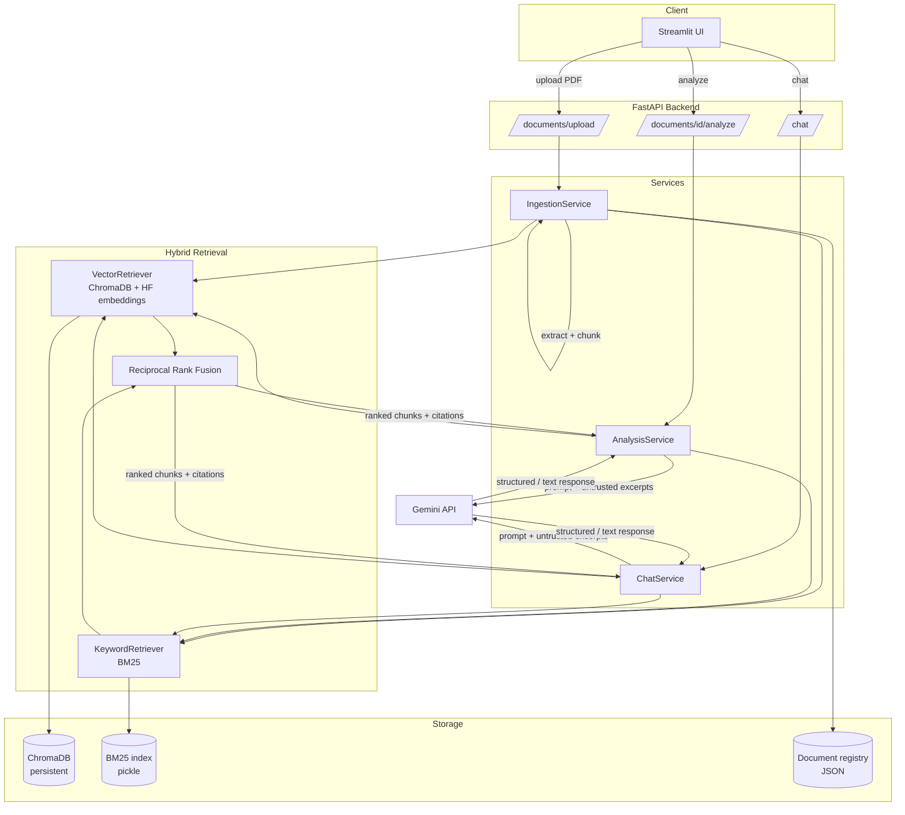

# Architecture

## Overview

The Newsletter Intelligence System is a modular monolith: one Python
codebase, one FastAPI process, one Streamlit process, no microservices, no
message queue, no external database beyond the embedded ChromaDB store.
That is a deliberate choice for this project's scale (single-user,
portfolio-scale document volumes) - see "Why not X" in
[`interview-guide.md`](interview-guide.md) for the reasoning behind each
technology choice.



## Request flow

### Ingestion

```
PDF upload -> validate (extension, size, non-empty, magic bytes)
           -> compute SHA-256 content hash -> dedupe check
           -> extract text per page (PyMuPDF)
           -> page-aware chunk (RecursiveCharacterTextSplitter)
           -> embed + index chunks into ChromaDB
           -> tokenize + index chunks into BM25
           -> persist document metadata (status=ready)
```

### Analysis (summary / insights / actions / entities)

```
document_id -> hybrid retrieval (broad query, top_k=ANALYSIS_TOP_K, scoped to document)
            -> build prompt with numbered excerpts
            -> Gemini generates structured JSON (incl. excerpt_refs per item)
            -> validate JSON against Pydantic schema
            -> resolve excerpt_refs -> real chunk metadata -> Citation objects
            -> return AnalysisResult
```

### Chat

```
user message -> (optional) rule-based follow-up query rewrite using last user turn
             -> hybrid retrieval (top_k=RETRIEVAL_TOP_K, scoped to document_id)
             -> if no chunks retrieved: return "insufficient evidence" (no LLM call)
             -> build prompt (retrieved excerpts + bounded history)
             -> Gemini generates a plain-text answer
             -> citations = metadata of chunks that were in context (not LLM-stated)
             -> return ChatResponse
```

## Module layout

```
app/
  api/routes/        FastAPI routers - thin, delegate to services
  core/               config, logging, exceptions
  schemas/            Pydantic models (request/response + internal results)
  services/           business logic: ingestion, document mgmt, analysis, chat
  retrieval/          vector/keyword retrievers, RRF fusion, hybrid retriever
  llm/                LLM client abstraction + Gemini adapter + prompts
  repositories/       document metadata persistence (JSON-backed)
  utils/              PDF loading, page-aware chunking
ui/                   Streamlit app + API client
scripts/              CLI ingestion, sample data generation, retrieval evaluation
tests/                unit / integration / api
docs/                 this file, evaluation methodology, interview guide
```

## Why page-aware chunking (not whole-document chunking)

Chunking happens **per page**, before concatenation. If chunks could span
page boundaries, a single chunk might contain text from two pages, making
its citation ambiguous. By chunking within each page independently, every
chunk has exactly one unambiguous `page_number`, which is what lets the
system cite "Newsletter.pdf — Page 5" with confidence instead of guessing.

## Why 1000-character chunks / 150-character overlap

Newsletters are short, prose-heavy documents (typically 1-10 pages). A
1000-character chunk (roughly 150-220 words) is large enough to hold a
complete thought or paragraph - important for keeping insights and action
items coherent - while small enough that hybrid retrieval returns focused,
relevant excerpts rather than diluting a query match across an entire
page. 150 characters of overlap (~15%) reduces the chance that a sentence
spanning a chunk boundary loses its surrounding context. Both are
environment-configurable (`CHUNK_SIZE`, `CHUNK_OVERLAP`) rather than
hardcoded, since the right values depend on document style.

## Anti-hallucination / citation design

The single most important invariant in this system: **the LLM never gets
to assert a page number, document ID, or chunk ID that ends up in a
citation shown to the user.**

- For chat, citations are built directly from the metadata of chunks that
  were retrieved and placed into context - not from anything the model
  says about its sources.
- For analysis, the model is asked to reference excerpt *numbers*
  (`[Excerpt 3]`) rather than page numbers. The service then resolves
  those numbers back to the real retrieved-chunk metadata. If the model
  invents a number outside the range of excerpts it was shown, that
  reference is silently discarded rather than surfaced as a fabricated
  citation (see `AnalysisService._resolve_citations`).
- If retrieval returns no chunks for a chat question, the system returns
  the "insufficient evidence" message **without calling the LLM at all** -
  there's nothing for it to hallucinate about.

## Security: prompt injection from PDF content

PDF content is treated as **untrusted data**, never as instructions. Both
system prompts (`app/llm/prompts.py`) explicitly tell the model that text
inside the excerpt blocks may contain fake instructions ("ignore previous
instructions...") and that such text must be treated as content to analyze,
never as a command. This is defense-in-depth, not a guarantee - a
sufficiently adversarial document could still influence model *output*
text. What actually bounds the blast radius structurally:

- `document_id` is always set server-side from the authenticated request
  path/body, never parsed from model output.
- Citations are derived from retrieval metadata, not from the model (see
  above) - so even if the model's prose is influenced by injected text, it
  cannot forge a citation to a document/page that wasn't actually
  retrieved.
- The model has no tool-calling or code-execution capability in this
  system - it only produces text that is rendered or JSON that is
  schema-validated. There is nothing a malicious instruction could get the
  model to "do" beyond writing unwanted text, which a validation failure
  or an odd-looking chat answer would surface.
- Retrieval is always scoped to the single `document_id` the user is
  interacting with (see `ChatService.chat`), so one document's content -
  injected or not - cannot pull context from a different document.

See `data/sample/sample_newsletter.pdf` (page 3) for a working example of
an injection attempt embedded in sample content, used in
`scripts/evaluate_retrieval.py` style manual testing.

## Logging policy

Logged: request ID, HTTP method/path/status/duration, ingestion
status transitions, retrieval duration (implicit via request duration),
and exception stack traces on failure.

Never logged: the Gemini API key or any `.env` value, full document text,
full chat message content, or unbounded conversation history. See
`app/core/logging.py` and `app/main.py`'s request-logging middleware.

## Known limitations

- **No OCR.** Scanned/image-only PDFs will extract little or no text.
  `IngestionService` detects this (zero chunks after extraction) and fails
  the upload with a clear error rather than silently indexing nothing.
- **Single-document chat by default.** The retrieval layer already accepts
  an optional `document_id` filter and is architected so multi-document
  retrieval (dropping that filter, or accepting a list of IDs) is a small,
  additive change - see `HybridRetriever.retrieve`. It isn't exposed in
  the UI/API today because the spec prioritizes correctness of
  single-document grounding first.
- **JSON-file document registry**, not a database. Fine at this scale
  (see `app/repositories/document_repository.py`); would be the first
  thing to swap for a real database in a multi-user deployment.
- **No authentication/authorization.** Out of scope for a local portfolio
  project; see "What would change in production" in the interview guide.
